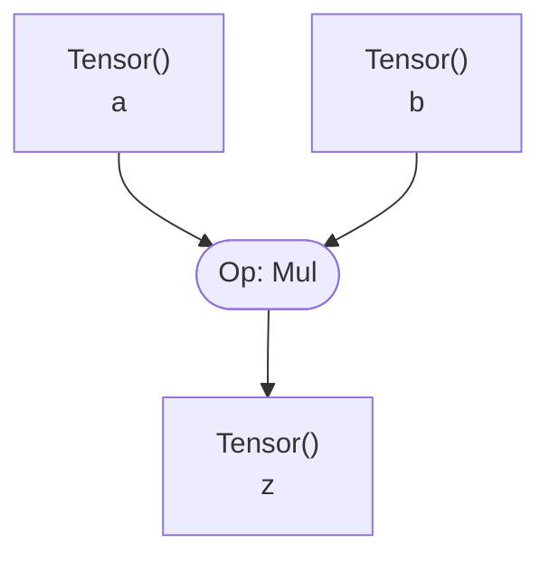
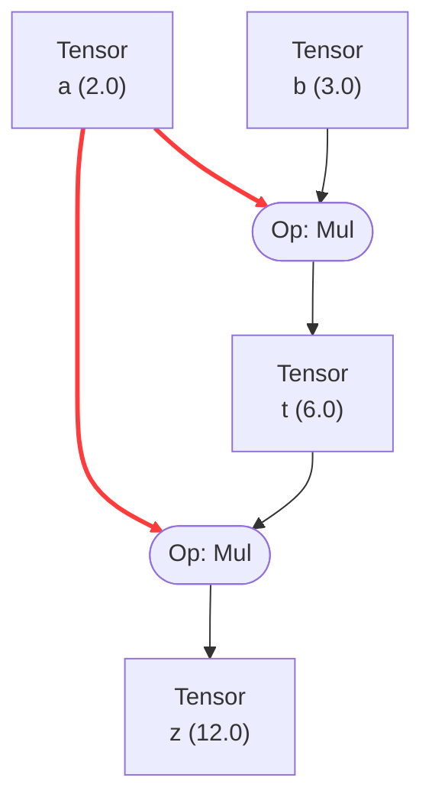

# tensors-from-arrays-to-autograd

Youtube Walkthrough: [Implementing Tensors: From Arrays to Autograd](https://youtu.be/WHPWau5Z-S8)  

A minimal tensor library built from scratch in Python — exploring tensor operations, computation graphs, automatic differentiation (autograd), and an MNIST classifier  — with **zero machine-learning framework dependencies**. Just NumPy (CPU) or CuPy (GPU).

The goal of this project is educational: to demystify the two ideas that power every modern deep learning framework — **tensors with automatic differentiation** and **the computation graph**. Everything here is written in plain, heavily commented Python so you can read it, run it, and truly understand what happens when a framework like PyTorch trains a network.

> ⚠️ This is a learning tool, not a production library. It trades performance and completeness for readability.

---

## Table of contents

- [What it teaches you](#what-it-teaches-you)
- [Features](#features)
- [Project structure](#project-structure)
- [Installation](#installation)
- [Quick start](#quick-start)
- [Running the demos](#running-the-demos)
- [Training MNIST](#training-mnist)
- [How autograd works](#how-autograd-works)
- [API overview](#api-overview)
- [Concepts covered](#concepts-covered)
- [License](#license)

---

## What it teaches you

Walking through this codebase, in order, teaches the complete inner workings of a deep learning framework:

1. **Tensors** — a multi-dimensional array that remembers *how it was created*, so gradients can later flow back through it.
2. **Operations** — each math operation (`+`, `-`, `*`, `/`, `matmul`, `relu`, `softmax`, `cross_entropy`) knows both how to compute its output and how to compute its derivative.
3. **The computation graph** — every tensor keeps a pointer to the operation (and its parent tensors) that produced it, forming a DAG.
4. **Backpropagation** — `backward()` walks that graph in reverse topological order, applying the chain rule to compute the gradient of a scalar with respect to every parameter.
5. **Neural network primitives** — layers, activations, a loss function, and an optimizer built on top of the autograd engine.
6. **Bridging CPU and GPU** — a tiny backend abstraction lets the *same* code run on NumPy or CuPy by simply setting an environment variable.

---

## Features

- **Automatic differentiation** via a dynamic computation graph
- **Operator overloading** — write expressions like `z = (a + b) * (a - b)` naturally
- **Computation graph visualization** — print a textual graph, or generate a rendered [Mermaid](https://mermaid.live) diagram of any expression
- **Neural network API** — `Module`, `Linear`, and `SGD`, mirroring PyTorch's mental model
- **Losses and activations** — `relu`, `softmax`, `cross_entropy_loss`
- **Built-in datasets** — MNIST and Fashion-MNIST, downloaded and parsed from scratch
- **An interactive prediction viewer** to inspect where your model is right and wrong
- **CPU / GPU switch** — NumPy by default, CuPy when `USE_GPU=1`

---

## Project structure

```
├── nn/                      # The library itself
│   ├── tensor.py            # Tensor + autograd engine (graph traversal, backward)
│   ├── operations.py        # Operation base class and all forward/backward impls
│   ├── functional.py        # Functional API: matmul, relu, softmax, cross_entropy
│   ├── modules.py           # Module, Linear, SGD
│   ├── array_backend.py     # NumPy <-> CuPy backend selection
│   ├── datasets.py          # MNIST / Fashion-MNIST download + parsing
│   └── visualization.py     # Interactive matplotlib prediction viewer
├── demo.py                  # Guided walkthrough of tensors and backprop
├── video-part1.py           # Minimal example used in the YouTube video
├── train.py                 # Trains an MLP on MNIST (CPU or GPU)
├── pyproject.toml
└── uv.lock
```

---

## Installation

This project uses [`uv`](https://docs.astral.sh/uv/) for dependency management and requires **Python 3.13+**.

```bash
git clone https://github.com/Logon27/tensors-from-arrays-to-autograd.git
cd tensors-from-arrays-to-autograd

uv sync                 # CPU only — installs numpy + matplotlib (no CuPy)
uv sync --extra cuda    # GPU — also installs CuPy
```

> 💡 The `cuda` extra installs `cupy-cuda13x`. Depending on your GPU's CUDA version you may need a different CuPy wheel (e.g. `cupy-cuda12x`). The backend gracefully falls back to CPU if CuPy fails to import.

---

## Quickstart

```python
from nn import Tensor

a = Tensor(2.0, requires_grad=True)
b = Tensor(3.0, requires_grad=True)

# Build a computation graph with ordinary Python expressions
z = (a + b) * (a - b)   # simplifies to a^2 - b^2

z.backward()

print(z)           # -5.0
print(a.grad)      # 4.0   (dz/da = 2a)
print(b.grad)      # -6.0  (dz/db = -2b)
```

Graphs are inspectable. Print the graph or open it in Mermaid:

```python
z.mermaid_graph() # prints a rendered diagram URL
z.print_graph()   # prints text tree in console
```

---

## Running the demos

`demo.py` is a guided, section-by-section tour of the core ideas — worth reading top to bottom alongside the comments in `nn/tensor.py`.

```bash
uv run demo.py
```

`video-part1.py` is a tiny, self-contained example that generates a computation graph visualization (used in the companion YouTube video):

```bash
uv run video-part1.py
```

---

## Training MNIST

`train.py` defines a two-layer MLP (784 → 128 → 10) and trains it on MNIST using backpropagation through the autograd engine.

```bash
# CPU Only
uv run train.py

# GPU (Linux / macOS)
USE_GPU="1" uv run train.py

# GPU (Windows PowerShell)
$env:USE_GPU="1"; uv run train.py
```

You should see per-epoch output like:

```
Epoch  1/10 | Avg Loss: 0.5753 | Test Accuracy: 91.08%
...
Training completed in 4.90 seconds.
```

At the end of training, the script opens an **interactive prediction viewer** showing 12 test images at a time, color-coded green (correct) or red (incorrect), with Previous/Next buttons. To train on Fashion-MNIST instead, run `uv run train.py --dataset fashion_mnist`. 

---

## How autograd works

This section is the heart of the project. The design is split into two halves:

### The forward pass: building the graph

Every user-facing operation on a `Tensor` goes through `Tensor._apply_op`, which:

1. Instantiates an `Operation` (e.g. `Mul`),
2. Runs `operation.forward(...)` on raw ndarrays,
3. Records the operation and its parents on the resulting tensor.



**IMPORTANT:** An operation is retained in the computation graph ONLY when at least one input has `requires_grad=True`. In that case, all of its input tensors appear as parents in the graph, including inputs that do not require gradients; those inputs simply do not receive gradients during backpropagation. If no input requires gradients, the operation metadata is discarded and the result becomes a plain buffer — this pruning is why inference is cheap.

### The backward pass: the chain rule

Each `Operation` implements two methods:

- `forward(inputs) -> output`
- `backward(grad_output) -> grad_inputs`

`backward` does two things: first it computes the operation's **local derivatives**, then it multiplies each of them by the incoming `grad_output` (the upstream gradient) to produce the `grad_inputs` (the downstream gradients) it returns. For multiplication, the forward is `f(x, y) = x · y`, so the local derivatives are `∂f/∂x = y` and `∂f/∂y = x`, giving:

```text
grad_inputs = (grad_output * y,  grad_output * x)
```

This is the chain rule in miniature form: `dL/dx = dL/df · ∂f/∂x`.

---

### Tensor.backward()

This is the orchestrator that walks the graph and applies each operation's `backward` in turn:

1. Seeds the gradient of the scalar output with `1` (the derivative of anything with respect to itself),
2. Runs a **topological sort** of the graph, then iterates in **reverse**,
3. At each node, calls `operation.backward(node.grad)` and distributes the results to the node's parents, **accumulating** into each parent's `.grad` — this is how variables that are used more than once (like `x` in `x * x`) correctly receive the sum of all incoming gradients.

#### A Simple Chain

Let's trace the **simplest** graph first — a single chain of two multiplications, with no branching or shared variables. Two ops deep, so you can watch the gradient actually *flow*:

```text
Forward:  z = a * b * c        with a = 2, b = 3, c = 4

Since `a * b * c` is parsed as two separate multiplications, the
library creates an intermediate tensor `t = a * b` (value 6) behind
the scenes:

  t = a * b        value: 6      (inner Mul)
  z = t * c        value: 24     (outer Mul)

Backward (reverse topological order). Each line takes the upstream
gradient and multiplies it by the operation's local derivative:

    dL/dz = 1                (seed: the derivative of z w.r.t. itself)
    dL/dc = 1 × t   =  6     (Mul: ∂f/∂c = t)
    dL/dt = 1 × c   =  4     (Mul: ∂f/∂t = c)
    dL/da = 4 × b   = 12     (Mul: ∂f/∂a = b)
    dL/db = 4 × a   =  8     (Mul: ∂f/∂b = a)
```

The key line is `dL/dt = 4` — no longer `1`. That `4` is *handed down* as the `grad_output` of the inner `Mul`, which multiplies it by `b` and `a`. This hand-off is the whole chain rule: `dL/da = dL/dt · ∂t/∂a`.

#### A Shared Variable

Now the interesting case: what happens when the **same variable is used more than once**? The gradient has to be **accumulated** from every path that reaches it — this is exactly what `Tensor._accumulate_grad` does: instead of overwriting `.grad`, it adds each incoming contribution to whatever is already there.

```text
Forward:  z = a * (a * b)        with a = 2, b = 3

`a` appears twice, so the graph reaches it by two paths. `b` appears
once, so it's reached by a single path:

  t = a * b        value: 6      (inner Mul)
  z = a * t        value: 12     (outer Mul)
```

Notice `a` has **two outgoing edges** (both red below) — one into each `Mul` — which is why it receives two gradient contributions:



Backward (reverse order). `a` receives one contribution from each `Mul`:

```text
  dL/dz = 1
  dL/da = dL/dz × t = 1 × 6 = 6        (outer Mul: ∂f/∂a = t)
  dL/dt = dL/dz × a = 1 × 2 = 2        (outer Mul: ∂f/∂t = a)

  dL/da = dL/dt × b = 2 × 3 = 6        (inner Mul: ∂f/∂a = b)
  dL/db = dL/dt × a = 2 × 2 = 4        (inner Mul: ∂f/∂b = a)

  a.grad = 6 + 6 = 12                  (accumulated from both paths)
  b.grad = 4                           (single path)
```

Here `a` receives two separate contributions — one from the outer `a * t` and one from the inner `a * b` — and `_accumulate_grad` sums them (`6 + 6`) into `a.grad`. Meanwhile `b` flows through a single path, so its gradient (`4`) is stored with no accumulation needed.

#### Broadcasting

There's one more subtlety: when a gradient's shape doesn't match its parent, `Tensor._reduce_grad` shrinks the gradient back to the parent's shape before it's accumulated. For example, a bias vector of shape `(10,)` added to a matrix of shape `(128, 10)` is broadcast across all 128 rows in the forward pass:

```text
Forward:  out = x + b        x: (128, 10)   b: (10,)

Backward: the gradient of `out` comes back with shape (128, 10),
but `b` is only (10,). _reduce_grad sums over the batch axis (axis 0)
to shrink it back to (10,) before adding it to b.grad:

  dL/db = sum(dL/dout, axis=0)     -> shape (10,)
```

---

## API overview

### `Tensor`

| Member | Description |
| --- | --- |
| `Tensor(data, dtype="float32", requires_grad=False)` | Create from a scalar, list, or ndarray |
| `Tensor.zeros(shape, dtype="float32", requires_grad=False)` | Create a zero-filled tensor |
| `.shape`, `.dtype`, `.data`, `.grad` | Shape, dtype, underlying ndarray, accumulated gradient |
| `.sum()` | Sum all elements into a scalar tensor |
| `.backward()` | Backpropagate from this (scalar) tensor |
| `.numpy()` | Return data as a NumPy array (converts from CuPy to CPU when needed) |
| `.mermaid_graph()` / `.print_graph()` | Visualize the computation graph |
| `+ - * /` | Arithmetic operators (with reflected variants) |

### Functions

| Function | Description |
| --- | --- |
| `matmul(x, w)` | Matrix multiplication |
| `relu(x)` | ReLU activation |
| `softmax(x)` | Numerically-stable softmax over class dimension |
| `cross_entropy_loss(probs, targets)` | Cross-entropy from probabilities and one-hot targets |

### Modules

| Class | Description |
| --- | --- |
| `Module` | Base class — subclass and implement `forward()` |
| `Linear(in_features, out_features)` | Affine layer: `matmul(x, w) + b` |
| `SGD(parameters, learning_rate)` | SGD optimizer with `step()` and `zero_grad()` |

### Datasets

| Function | Description |
| --- | --- |
| `datasets.mnist()` | Download, flatten, normalize, one-hot encode MNIST |
| `datasets.fashion_mnist()` | Same for Fashion-MNIST |

---

## Concepts covered

Solid foundational knowledge you'll gain by studying this code:

- Reverse-mode automatic differentiation and the chain rule
- Computational graphs as directed acyclic graphs (DAGs)
- Topological sorting for gradient propagation
- Gradient accumulation for shared sub-expressions
- Broadcasting and its gradient reduction
- The Module / Layer / Optimizer separation of concerns
- One-hot encoding and cross-entropy loss
- Mini-batch stochastic gradient descent
- Writing framework-agnostic code that runs on NumPy or CuPy

---

## License

[MIT](./LICENSE) © 2026 Logan Zehm